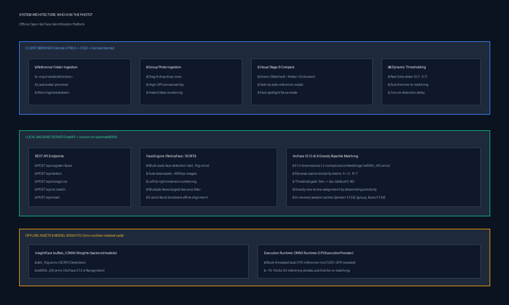

# 🏗 Architecture (`ARCHITECTURE.md`)

## 1. System Architecture Diagram

> Generated with [Archify](https://github.com/tt-a1i/archify)



---

## 2. System Overview

The application follows a clean, decoupled **client-server architecture** with a Python backend and a browser-based frontend, running entirely locally and offline on the user's laptop.

```
┌────────────────────────────────────────────────────────────────────────┐
│                          BROWSER (Frontend)                            │
│                                                                        │
│  ┌──────────────┐   ┌──────────────┐   ┌────────────────────────────┐  │
│  │ Folder       │   │ Group Photo  │   │ Visual Canvas & Results    │  │
│  │ Ingestion    │   │ Ingestion    │   │ (Spotlight, Compare Modal) │  │
│  │ (webkitdir)  │   │ (Drop zone)  │   │                            │  │
│  └──────┬───────┘   └──────┬───────┘   └─────────────▲──────────────┘  │
│         │                  │                         │                 │
└─────────┼──────────────────┼─────────────────────────┼─────────────────┘
          │                  │                         │
     POST /api/         POST /api/               JSON response
     register-faces     recognize            (bboxes, names, scores)
          │                  │                         │
┌─────────┼──────────────────┼─────────────────────────┼─────────────────┐
│         ▼                  ▼                         │                 │
│  ┌───────────────────────────────────────────────────┴──────────────┐  │
│  │                FastAPI Application (main.py)                     │  │
│  │                                                                  │  │
│  │  /api/register-faces  →  Ingests folder, derives names, embeds   │  │
│  │  /api/detect          →  Locates group faces at original scale   │  │
│  │  /api/recognize       →  End-to-end recognition & greedy match   │  │
│  │  /api/re-match        →  Instant threshold re-eval on cache      │  │
│  │  /api/reset           →  Clears session memory and caches        │  │
│  │  GET /                →  Serves static frontend (HTML/CSS/JS)    │  │
│  └───────────────────────────────────┬──────────────────────────────┘  │
│                                      │                                 │
│  ┌───────────────────────────────────▼──────────────────────────────┐  │
│  │                      FaceEngine (face_engine.py)                 │  │
│  │                                                                  │  │
│  │  ┌────────────────────────┐      ┌────────────────────────────┐  │  │
│  │  │  SCRFD Face Detector   │─────▶│  ArcFace Feature Extractor │  │  │
│  │  │  (det_10g.onnx)        │      │  (w600k_r50.onnx, 512-d)   │  │  │
│  │  │  Auto-scales >4000px   │      │  5-pt affine normalization │  │  │
│  │  └────────────────────────┘      └──────────────┬─────────────┘  │  │
│  │                                                 │                │  │
│  │  ┌──────────────────────────────────────────────▼─────────────┐  │  │
│  │  │             Greedy Bipartite Matching Engine               │  │  │
│  │  │                                                            │  │  │
│  │  │  1. Pairwise Cosine Similarity: S = G · R^T                │  │  │
│  │  │  2. Threshold Filter: S[i, j] >= tau (default 0.40)        │  │  │
│  │  │  3. Greedy 1-to-1 Assignment (descending similarity)       │  │  │
│  │  │  4. Unmatched / Sub-threshold Group Faces → "Unknown"      │  │  │
│  │  └────────────────────────────────────────────────────────────┘  │  │
│  │                                                                  │  │
│  │  ┌────────────────────────────────────────────────────────────┐  │  │
│  │  │                    In-Memory Session Store                 │  │  │
│  │  │  registered_faces: { person_name -> 512-d ndarray }        │  │  │
│  │  │  group_faces: [ { bbox, embedding, det_score } ]           │  │  │
│  │  │  group_image_shape: (original_h, original_w)               │  │  │
│  │  └────────────────────────────────────────────────────────────┘  │  │
│  └──────────────────────────────────────────────────────────────────┘  │
│                                                                        │
│                        BACKEND SERVER (Python)                         │
│                    Runs locally on http://127.0.0.1:8000               │
└────────────────────────────────────────────────────────────────────────┘

┌────────────────────────────────────────────────────────────────────────┐
│             InsightFace Model Weights (buffalo_l pack)                 │
│              Stored locally in backend/models/models/                  │
│              - det_10g.onnx (SCRFD multi-scale face detector)          │
│              - w600k_r50.onnx (ArcFace ResNet-50 512-d recognizer)     │
└────────────────────────────────────────────────────────────────────────┘
```

---

## 3. Data Flow

### A. Reference Registration Flow
```
User Folder (50 files)
  │
  ▼
Browser reads via <input webkitdirectory>
  │
  ▼
POST /api/register-faces (Multipart form)
  │
  ▼
FastAPI sanitizes filename ('Priya_Sharma.jpg' -> 'Priya Sharma')
  │
  ▼
FaceEngine._prepare_image() -> InsightFace SCRFD
  │ (If multiple faces -> picks largest bbox area; If no face -> skips & logs warning)
  ▼
ArcFace 5-point affine alignment -> 112×112 tensor -> 512-d L2-normalized vector
  │
  ▼
Stored in-memory: registered_faces[name] = vector
  │
  ▼
Returns JSON: { registered: 50, total_files: 50, warnings: [...] }
```

### B. Recognition Flow
```
Group Photo Upload
  │
  ▼
POST /api/recognize (Multipart image)
  │
  ▼
FaceEngine detects all faces via SCRFD -> extracts 512-d ArcFace embeddings
  │
  ▼
Caches group embeddings and original bounding boxes in memory (group_faces)
  │
  ▼
Computes pairwise Cosine Similarity Matrix: S = G · R^T
  │
  ▼
Filters pairs where S[i, j] >= threshold (default 0.40)
  │
  ▼
Greedy One-to-One Assignment (highest similarity pairs locked first)
  │ (Guarantees no employee is assigned twice; non-matches marked "Unknown")
  ▼
Returns JSON: { faces: [...], total_detected: N, matched: M, unknown: U }
  │
  ▼
Browser renders Canvas overlay (Green for matched, Amber for unknown),
populates results sidebar, and caches original reference images for side-by-side comparison.
```

### C. Real-Time Re-match Flow
```
User drags Similarity Threshold Slider (e.g. 0.40 -> 0.55)
  │
  ▼
POST /api/re-match { "threshold": 0.55 }
  │
  ▼
Re-runs matching logic on cached embeddings in <5ms (zero neural network inference)
  │
  ▼
Returns updated classification JSON -> Browser redraws boxes and updates list
```

---

## 4. Trade-offs & Decisions

| Decision Area | Selected Approach | Alternative Rejected | Rationale |
|---|---|---|---|
| **Face Detection** | RetinaFace / SCRFD (`buffalo_l`) | MediaPipe / dlib HOG | Group photos contain small, distant faces and side profiles. Missing a face during the demo is a critical failure. Accuracy is worth a few extra seconds. |
| **Face Recognition** | ArcFace 512-d (`w600k_r50`) | dlib 128-d / FaceNet | With only 1 reference photo per person (extreme one-shot), ArcFace's angular margin loss minimizes false-positive collisions and leads open-set benchmarks. |
| **Matching Algorithm** | Greedy Bipartite Assignment | Hungarian Algorithm / $k$-NN | Greedy assignment is intuitive, runs in $\mathcal{O}(K \log K)$, is easy to explain, and yields identical results when ArcFace margins are clean. |
| **Frontend Stack** | Vanilla HTML5 + CSS3 + JS | React / Next.js / Vite | Zero build step. Eliminates Node.js version conflicts or `npm install` failures on evaluator laptops. |
| **State Storage** | In-Memory Python Dictionaries | SQLite / Redis | 50 reference vectors of 512 floats require under $150\text{KB}$ of RAM. A database adds unnecessary dependencies and operational complexity. |
| **Runtime Execution** | Local CPU (ONNX Runtime) | CUDA / GPU Acceleration | Guarantees universal compatibility across all evaluator Mac/Windows laptops without GPU drivers or CUDA toolkit dependencies. |
| **Deployment Model** | Direct Python Server | Docker Container | Docker adds setup overhead and virtualization latency for the evaluator. Running `python main.py` is immediate. |
| **Image Preprocessing** | Native Affine Alignment | Super-Resolution (ESRGAN) | ArcFace normalizes all faces to $112\times112$ internally. Super-resolution hallucinates artificial details that degrade similarity accuracy. |

---

## 5. Architectural Trade-offs

### Accuracy vs. Speed
- **The Choice:** Prioritizing **accuracy over raw speed**.
- The `buffalo_l` pack is InsightFace’s highest accuracy model. Processing 50 reference photos takes $\approx 10\text{–}15$ seconds on CPU, while inference on a 10-person group photo takes $\approx 1.5\text{–}2$ seconds.
- A lighter model (`buffalo_sc`) would execute faster but yields significantly lower recall on small faces. For a live demo on unseen data, high detection and recognition recall is paramount.

### Simplicity vs. Feature Bloat
- **The Choice:** A streamlined, reliable single-page experience over a complex multi-view dashboard.
- Features such as multi-photo clustering, database persistence, and user authentication were intentionally excluded. The application solves the target problem with zero runtime friction and maximum stability.
