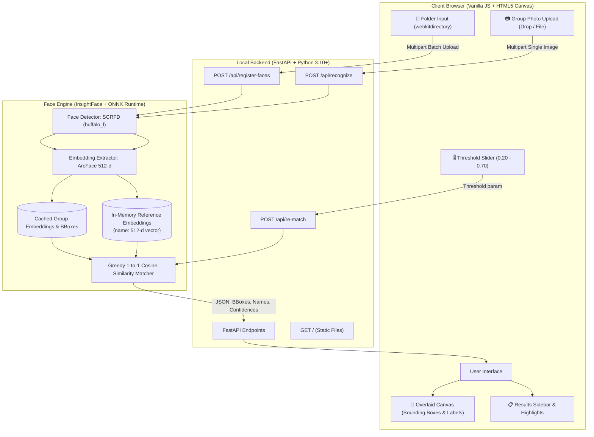

# System Architecture (`ARCHITECTURE.md`)

## 1. System Overview

"Who Is in the Photo?" is an offline, privacy-first face recognition web application. The platform detects, embeds, and matches human faces from an uploaded group photo against a reference directory of known individuals.

---

## 2. Component Breakdown

### A. Web Client (`frontend/`)
- **Zero-Build Architecture:** Implemented in pure HTML5, CSS3, and standard ES6+ JavaScript. No node dependencies or bundlers required.
- **Dynamic Canvas Overlay:** Synchronizes a transparent `<canvas>` strictly over the rendered dimensions of the group photo. Draws color-coded bounding boxes:
  - **Green (`#10B981`):** Identified registered individuals.
  - **Orange (`#F59E0B`):** Unidentified ("Unknown") individuals.
- **Interactive Highlighting:** Two-way selection linking sidebar list items to specific bounding boxes on the canvas.

### B. REST API Layer (`backend/main.py`)
- **Framework:** FastAPI running on Uvicorn.
- **Endpoints:**
  - `POST /api/register-faces`: Ingests multipart files from the reference folder, extracts face embeddings, populates reference dictionary, and yields diagnostics/warnings.
  - `POST /api/recognize`: Ingests group photo, detects all faces at high resolution (1280px detection scale), generates ArcFace embeddings, runs greedy one-to-one matching, caches group embeddings, and returns bounding box coordinates and identities.
  - `POST /api/re-match`: Re-evaluates cached group embeddings against reference vectors with an updated threshold in <5ms without re-running detection models.
  - `GET /api/health`: Health status monitor.

### C. Offline Face Engine (`backend/face_engine.py`)
- **Detector:** SCRFD from InsightFace `buffalo_l` pack. Executes via ONNX Runtime on CPU.
- **Embeddings:** ArcFace ResNet50 (512-dimensional L2-normalized float32 vectors).
- **Matching Pipeline:**
  1. $\mathbf{S} = \mathbf{G} \cdot \mathbf{R}^T \in \mathbb{R}^{M \times N}$ where $\mathbf{G}$ is $M \times 512$ and $\mathbf{R}$ is $N \times 512$.
  2. Filter pairs where $S_{ij} \ge \tau$.
  3. Sort pairs descending by similarity.
  4. Greedily assign identities ensuring each person in the reference folder is matched at most once in the photo.

---

## 3. Trade-offs & Decisions

| Decision | What We Chose | What We Gave Up | Rationale |
|---|---|---|---|
| **Frontend Stack** | Vanilla HTML + CSS + JS | React / Vue / Vite | Guaranteed zero-friction startup on evaluator laptops without `npm install` or node version conflicts. |
| **Model Pack** | InsightFace `buffalo_l` | Lightweight `buffalo_sc` or dlib | Slightly higher RAM / disk footprint (~300MB) in exchange for vastly superior recall on small, angled, and partially occluded faces. |
| **Inference Engine** | ONNX Runtime (CPU) | PyTorch / CUDA | Eliminates multi-gigabyte GPU driver/toolkit dependencies; runs reliably on any modern laptop processor. |
| **Matching Algorithm** | Greedy Bipartite Matching | Hungarian / Munkres Algorithm or Independent Argmax | Greedy matching is intuitive, runs in $O(K \log K)$ where $K$ is the number of valid pairs, and strictly prevents duplicate person assignments without distortion. |
| **Re-matching Strategy** | Embedding Cache | Full re-detection on slider input | Sacrifices a negligible amount of memory to achieve real-time (<5ms) slider interactivity. |
